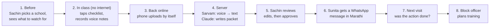
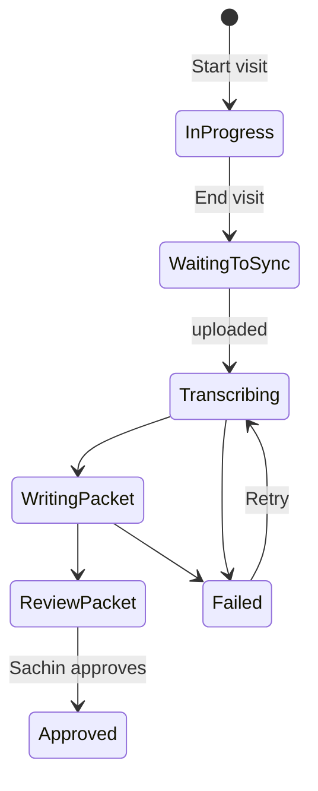
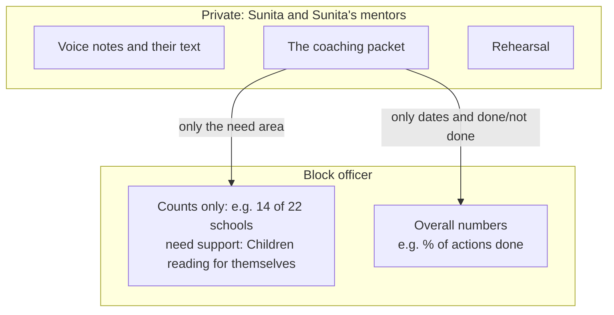

# How VisitCoach works

This doc explains the whole app in plain words, using one example visit from start to finish.
✅ = built and tested · ⏳ = not built yet. Updated 31 Oct for v2 ([PLAN_V2.md](PLAN_V2.md)), after the mentor review ([MENTOR.md](MENTOR.md)): coaching history across mentors, the advice inside the WhatsApp message, multi-grade classes, and Maharashtra first.

---

## The people and the parts

| Who / what | In plain words |
|---|---|
| **Mentor** | The government person who visits schools to help teachers teach better. In Maharashtra this is the **Kendra Pramukh** (cluster head); elsewhere often called a CRP. **Our main user.** Example: **Sachin**, who took over the cluster from **Vandana** this month. |
| **Teacher** | The Grade 1–3 teacher being observed. Example: **Sunita**, Grade 1, ZP School Wagholi (Pune). Sunita doesn't install anything, just gets a WhatsApp message. |
| **Block officer** | Plans training for the block. Sees which support schools need ("Support planning"), never individual teachers. |
| **The app (on the phone)** | What Sachin uses. It's a website that behaves like an app and **works without internet**. |
| **The server** | Our computer in the cloud. It stores visits and talks to the two AI services below. |
| **Sarvam** | An Indian speech-to-text service. It turns Sachin's Marathi voice notes into text (Hindi and Tamil also work, for the next states). |
| **Claude** | The AI that reads Sachin's notes and writes the coaching advice (the "packet"). |

**Coaching packet:** the one page of advice Claude writes after a visit, made of: one thing that went well, one thing to improve, a 5-minute practice for tomorrow, a short demo Sachin can model, and one agreed action to check next time.

---

## The whole journey in one picture

---

## Step by step, with the example

### Step 1: Before the visit ✅
**Sachin:** opens the app at home (with internet) and sees this week's schools. The first time, the app asks for Sachin's name; it goes with every visit, so teachers and later mentors know who gave which feedback.
**App:** shows a suggested focus for each school, based on its reading/maths levels, e.g. *"46% of children are at Beginner level in literacy. Watch whether children read on their own."*
**Behind the scenes:** the phone quietly **saves a copy** of the school list and the observation checklist, so they still open inside the school with no signal. While online, the phone also downloads an **offline pack** every couple of minutes: all schools, teachers, the checklist and the actions waiting to be checked.
**Coaching history ✅ (v2):** on the school page, each teacher has a **coaching history**: every earlier visit with the date, **which mentor** came, the focus, the agreed action, and whether it was done. Sachin is new to the cluster, but sees that Sunita had three visits from Kiran and Vandana, and what they agreed. This is in the offline pack, so it opens in school with no signal. (Mentor feedback #6: teachers get different mentors, so feedback broke off.)
The app itself is saved on the phone too (it's a PWA), so it **opens even with no signal**, as long as it was opened once with internet. Sachin can also **install** it on the home screen like a normal app.

### Step 2: In the classroom, offline ✅
**Sachin:** picks Sunita, presses **Start visit**, and watches for 20–30 minutes, meanwhile:
- notes **children present** (32) and **which grades sit together** (1 and 2, because the other teacher is on training) ✅ v2
- **taps the checklist**: 15 questions like *"Children read text themselves"*, each answered **Yes / Partly / No**, shown in Marathi with English underneath. It's a reading-and-maths **add-on** to the state's own observation checklist (KPALP), not a replacement
- **records voice notes** of up to 30 seconds each, as many as needed. A reminder on screen says not to record children's names.
- optionally **types a note**

**Behind the scenes:** every tap and recording is saved **on the phone immediately**, in the browser's storage (IndexedDB). If the app closes or the phone restarts, nothing is lost.

At the end, Sachin presses **End visit**. The visit is now *"Waiting to sync"*.

### Step 3: Back online, the phone uploads by itself ✅
Sachin doesn't press anything. The app checks every few seconds, and as soon as there's signal it **uploads the visit**: the checklist answers, the voice recordings and the typed note.
Uploading twice by accident is harmless, because the server recognises a visit it already has.

### Step 4: The server builds the coaching packet ✅ (voice part not yet tested with a real Sarvam key)
This takes about half a minute. Sachin watches the status change on the phone:

1. **"Transcribing notes…"**: each voice note goes to Sarvam and comes back as text.
2. **"Writing packet…"**: Claude gets the checklist answers, the note texts, the class and the language, plus Sunita's **last 3 agreed actions, which mentor agreed them, and whether they happened** (from Step 7), the **number of children** and **which grades sit together**. It also gets our **knowledge pack**: the checklist, 16 tried-and-tested 5-minute classroom practices, the government's Grade 1–3 learning goals (NIPUN Lakshyas) and 21 short quotes from official documents.
3. Claude writes the packet **in Sunita's language** and says which official document pages back its advice.
4. **Safety check:** the server confirms that Claude only used real checklist items, real practices and real document quotes. If not, Claude gets one more try.
5. **"Review packet"**: ready.

**Rules Claude follows when writing:**
- **Sunita's parts** are in Sunita's language: what went well, what to improve, the practice, the demo, the agreed action. They contain nothing meant only for Sachin.
- **Sachin's parts** are in English and plain words, never code names: the summary and the evidence.
- Neutral wording (we don't know if the mentor is a man or a woman), and no children's names, not even made-up ones.
- **Continue the plan, even across mentors:** mention progress on the last action, never set again an action already done, and make a not-done action smaller instead of repeating it.
- **Multi-grade:** if several grades sit together, choose a practice that works across levels (e.g. pair a Grade 2 reader with a Grade 1 child) and say how to split the class.
- With only checklist taps and no notes, Claude says so instead of inventing what happened. The advice is then general, so **always add at least one note.**

If something breaks (no internet on the server, AI error), the status shows **"Failed"** with the reason and a **Retry** button.

### Step 5: Sachin reviews and approves ✅
**Sachin** sees:
- a short **English summary** for the mentor
- the packet in Marathi, where every part is **editable** (Sachin saw the class; the AI might be wrong)
- **"Evidence from your notes"**: why Claude chose this priority
- **"Sources"**: the exact official pages, e.g. *"NIPUN Bharat guidelines, p.200"*
- **"Your notes, as the app heard them"**: the text Sarvam made from each voice note, so Sachin can spot mistakes
- **"Practise the conversation"**: opens the rehearsal (see Extra below)

Editing works with no signal; changes are saved on the phone. Then Sachin presses **Approve and share**. This step needs internet, and once approved the packet is locked.
**Safety net:** if Claude left a note meant for Sachin inside Sunita's text, like *"[Mentor: add an example here]"* (or *"[CRP: …]"*), that box turns red and **Approve stays blocked** until Sachin replaces or deletes it. The server checks this too. The first real packet had such a note.

**Behind the scenes:** we keep **both** Claude's original and Sachin's edited version. That tells us how often mentors need to fix the AI, which is one of our promised metrics.

### Step 6: Sunita gets the advice on WhatsApp ✅
Sachin taps **Send on WhatsApp**. WhatsApp opens with a short message **in Marathi**, already written from the approved packet: ✅ what went well, 🎯 one thing to work on, 📌 what they agreed, and a link for the details. Sachin sees exactly this message before sending it. So Sunita gets the advice itself in WhatsApp, which Sunita already uses, and the link is optional.
The link opens a page (no app, no login) with the full advice in Marathi: what went well, one thing to work on, the 5-minute practice, materials, and what they agreed. Below it is **"आतापर्यंतचे मार्गदर्शन" (your coaching so far)**: Sunita's earlier visits with the date, the mentor, the focus, the agreed action and whether it was done. Sunita can follow their own progress, whichever mentor came. No scores, no mentor notes, no evidence or sources, no AI details.

### Step 7: The next visit ✅
Two weeks later, Sachin opens Wagholi again (offline). The app shows:
> *Last time, Sunita agreed to try pair reading daily. Did it happen? ✅ Done / 🟡 Partly / ❌ Not done*

Sachin **checks it in person** in class, using the hint from the packet ("ask two back-row children to read with a partner"), and taps the answer. Sachin also asks Sunita how useful the advice was (1–5).
The answer is saved on the phone (it says *"saved on phone, sends when online"*) and uploaded later. Only Sunita's **latest** agreed action is asked about, even when another mentor agreed it (here, Vandana). The **next** packet then builds on the last 3 actions, e.g. *"Paired reading has started, good progress; now pair each back-row Grade 1 child with a Grade 2 reader."* (This is from a real packet in our 31 Oct test.)

### Step 8: Support planning for the block ✅
The block page is titled **"Support planning: what training does this cluster need?"**. It plans support, it doesn't monitor anyone. From the link at the bottom of the home screen (`/block`), the officer sees: *"14 of 22 schools need support: Children reading for themselves"*, plus overall numbers like "62% of agreed actions were done by the next visit". **Never** teacher names or scores. Any need covering fewer than 5 schools is grouped as "other", so nobody can guess which school it was.
It also shows the five numbers we promised in the proposal: time from observation to approved feedback, % of visits ending with an agreed action, % of actions done by the next visit, % of packets the mentor edited, and how useful teachers found the advice.
The demo comes with made-up history for 22 schools, so this page has numbers from the start.

### Extra: Rehearsal ✅ (needs internet)
Before talking to Sunita, Sachin can **practise** the conversation. Claude plays a slightly defensive teacher (*"I have 45 children, there's no time!"*), Sachin replies, and at the end Claude scores Sachin on five things (started with a strength, talked about what was seen, kept to one priority, asked Sunita's view, ended with one agreed action), with a tip and a better way to say the weakest line.

---

## What the status labels mean (on Sachin's phone)

| Label | What's happening |
|---|---|
| **In progress** | Sachin is still observing. Saved on the phone only |
| **Waiting to sync** | Visit ended; it uploads as soon as there's signal |
| **Transcribing notes…** | The server is turning the voice notes into text |
| **Writing packet…** | Claude is writing the coaching packet |
| **Review packet** | Ready for Sachin to read, edit and approve |
| **Failed** | Something went wrong. Shows the reason and a Retry button |
| **Approved** | Locked and ready to share with the teacher |

---

## Who sees what (privacy)

- **No child audio, no child names.** Sachin records only their own observations, away from the children.
- Sunita sees only the final advice and their own coaching history (dates, mentors, actions, done or not), never a mentor's raw notes or check notes.
- The next mentor at Sunita's school sees Sunita's coaching history, so the coaching continues when mentors change.
- All demo schools, teachers and numbers are **made up**.

---

## Where the AI is used

| When | What Claude does | Built? |
|---|---|---|
| After sync | Turns the checklist and notes into the coaching packet | ✅ |
| Rehearsal | Plays the teacher, then scores Sachin's feedback | ✅ |
| Block view (optional) | Writes a short summary of the counts, never seeing any notes | ⏳ |
| Testing | Grades our packets on practice cases (14 written so far, 2 of them multi-grade; target 50), to check quality | ✅ (not yet run) |

Sarvam is used only to turn voice into text.

---

## Words you'll see in the code

| Word | Meaning |
|---|---|
| **Rubric** | The 15-question classroom checklist |
| **Need area** | The group a checklist item belongs to, e.g. "Children reading for themselves". The block view counts these |
| **Practice** | One of 16 ready-made 5-minute classroom activities, e.g. Paired Reading |
| **Lakshya** | The government's official learning goal for a grade, e.g. "Class 2 reads 45–60 words per minute" |
| **Grounding** | Making the AI back its advice with real quotes from official documents |
| **Sync** | Uploading what's saved on the phone once there's internet |
| **IndexedDB / Dexie** | The storage inside the browser where the phone keeps visits offline (Dexie is the library we use for it) |
| **PWA** | A website that can be installed and used like an app, even offline |
| **Service worker** | The part of a PWA that keeps a copy of the app on the phone, so it opens with no signal |
| **Offline pack** | One download with everything a school visit needs (schools, teachers, checklist, open actions), refreshed every couple of minutes while online |
| **Coaching history** | A teacher's earlier visits: date, mentor, focus, agreed action, and whether it happened. Shown to the next mentor and to the teacher |
| **Outbox** | Answers made offline (like a follow-up check) that wait on the phone until there's signal |
| **Demo data** | The made-up history for 22 schools that the server creates on first start |
