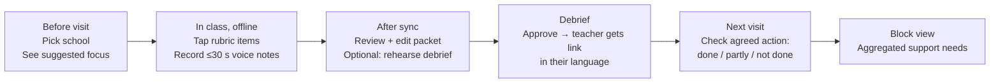
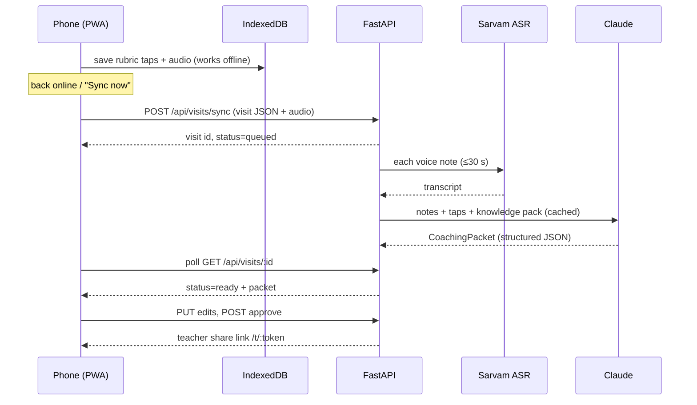
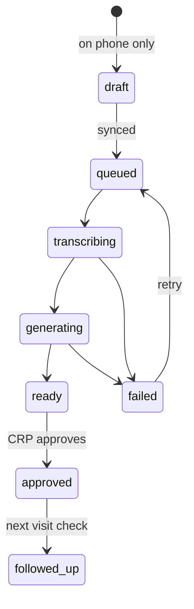
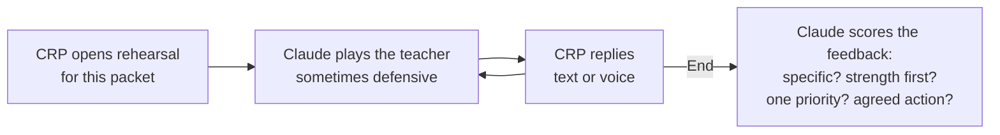
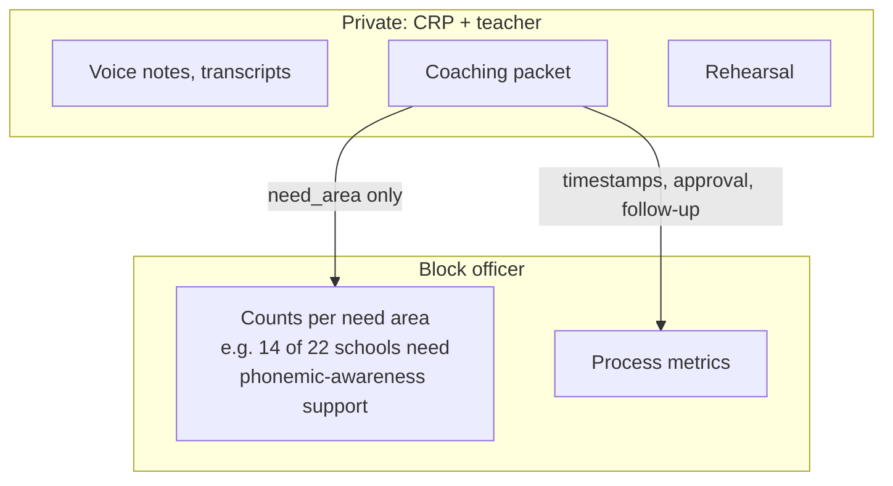

# How VisitCoach works

## 1. The CRP's visit (user journey)

## 2. From observation to coaching packet

## 3. Visit status

## 4. Rehearsal loop (optional feature)

## 5. Who sees what (two-tier data)

## 6. Where Claude is used

| Step | Service function | Input | Output | Effort |
|---|---|---|---|---|
| Coaching packet | `services/packet.py` | transcripts + rubric taps + grade/subject/language | strength, priority, 5-min practice, demo script, follow-up, evidence, need_area, grounded_in | medium |
| Rehearsal turn | `services/rehearsal.py` | packet + conversation so far | teacher's reply | low |
| Rehearsal score | `services/rehearsal.py` | conversation | scores + tips for the CRP | medium |
| Block narrative | `services/block.py` | aggregated counts only | short summary of support needs | medium |
| Eval judge | `eval/run_eval.py` | case + packet | scores per criterion | medium |

Every call shares one cached system prompt containing the FLN knowledge pack.
